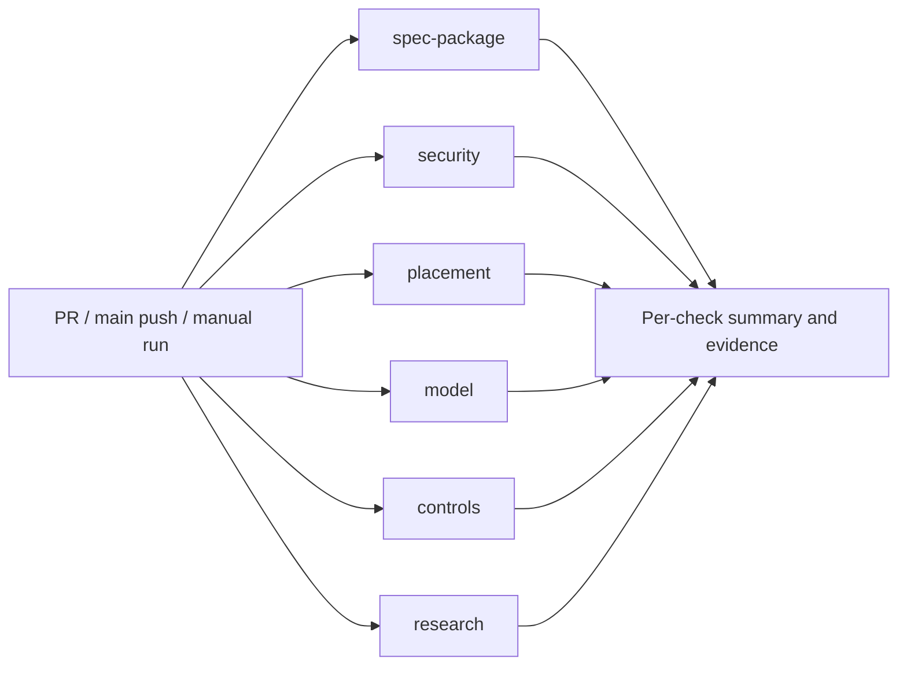

# CI and public research repository design

Status: implemented and extracted for public publication, 2026-10-22. See [RESEARCH.md](RESEARCH.md) for the experiments. The workflow is `.github/workflows/verify.yml`. Hosted results are recorded in
RESEARCH-RESULTS.md after execution.

## Purpose

Publish a small, reproducible research reference under `github.com/dio` with a
protocol spec, reference implementation, adversarial tests, and attributable
verification results. Repository: `dio/credential-distribution-lab`.
The repository is an experiment, not a deployable credential service or SDK.

The central question is whether scoped, authenticated background delivery into
private in-memory databases can support local, fail-closed upstream credential
resolution. Spec claims must remain tied to named tests and explicit limitations.

## Initial scope and evidence

Use the existing Go module and harness. Keep six independent checks:

| Check name | What runs | What passing establishes |
|---|---|---|
| `spec-package` | Formatting, vet, module verification, Markdown local-link checks, specification/test-name coverage, workflow lint | The reference is internally consistent and its documented checks exist |
| `security` | `./ci/run.sh security` | Authorized TLS delivery/use, private stores, replay/rollback rejection, rotation/revocation/expiry, and bounded resolution lifetime |
| `placement` | `./ci/run.sh placement` on a Linux runner with pinned Envoy and the real MCP fixture | Upstream bearer injection and backend non-dispatch on denial for the LLM/MCP paths |

| `model` | Bounded state exploration, permutations, seeded schedules and three guard-removal controls | The proposed activation/dispatch contract holds within the explored model; regressions detect targeted unsafe mutations |
| `research` | Eight concurrent local readers while installing revocation | Bounded progress and post-install denial on the tested runtime |
| `controls` | `TestSecurityReview*` and cold trusted-publisher rollback | Expected vulnerabilities/limitations are reproduced; this is not a mitigation check |

The security check uses actual Go HTTPS/gRPC clients. The placement check uses the
original plaintext auth fixture. Neither check, nor their combination, establishes
secured Envoy-to-subscriber integration or file-free identity provisioning.
That future experiment gets a separate check named `secured-envoy-e2e` once it exists.
Do not add an empty/skipped placeholder check that appears green.

The deliberately insecure `TestSecurityReview*` controls must be labelled
`expected vulnerability reproduced` in reports, not `security guarantees passed`.
Keep them because they demonstrate that the adversarial tests distinguish the
baseline fixture from the secured entrypoint.

## Repository shape

Extract only the self-contained spike, not the surrounding notes repository:

```text
README.md                  question, architecture, evidence table, quick start
SPEC.md                    normative rules with test references
CI-DESIGN.md                this design and remaining rollout work
SECURITY.md                research threat boundary and reporting guidance
SECURITY-REVIEW.md          threat analysis and mitigation history
SECURITY-RESULTS.md         dated evidence, environment, known gaps
RESULTS.md                 original placement observations
LICENSE                    Apache-2.0
THIRD_PARTY.md             MCP source provenance/license and dependency notices
*.go, go.mod, go.sum        reference and tests
fixture/mcp-main.go.txt     launcher built inside pinned upstream source
run-security.sh, run.sh     shared local/CI entrypoints
ci/versions.env            reviewed toolchain/source/image pins
ci/install-envoy.sh        extract pinned Envoy binary onto Linux runner
ci/check_results.py        mandatory test completion and evidence summary
ci/check_docs.py            local links and invariant-to-test references
.github/workflows/verify.yml
.github/dependabot.yml     future update automation, not installed
```

The standalone README links only to files shipped here. The module path is
`github.com/dio/credential-distribution-lab`; no stable library API is promised.
Generated logs, binaries, identities and credentials are excluded from Git.
Historical results remain dated and explicitly distinguish evidence tiers.

## Workflow graph and triggers



All six run on every pull request and push to main, including documentation-only
changes. Also expose `workflow_dispatch` and run the same pinned checks weekly to
detect source/dependency retrieval failures. Avoid path filters that leave required
checks pending. Configure the six stable names as required checks after the first
successful hosted run. Cancel superseded PR runs; keep main runs independent.

Use ephemeral GitHub-hosted Ubuntu runners, no self-hosted runner or cloud account.
Set workflow permissions to `contents: read`, disable persisted checkout credentials,
use ordinary `pull_request` events, and expose no repository secrets to tests.
Pin actions by full commit SHA, with human-readable version comments. Dependency
updates require review. Do not execute PR code through `pull_request_target`.
These choices follow [GitHub's secure-use guidance](https://docs.github.com/en/actions/reference/security/secure-use).

All jobs have a 20-minute outer limit. Go tests have a three-minute limit, or
five minutes for the full placement suite, so failures can produce evidence before
the runner terminates. These are CI budgets, not service latency guarantees.

## Reproducible integration environment

The implemented first version runs the harness and all child processes directly
on an Ubuntu 24.04 hosted runner. It extracts Envoy from the official image pinned
by digest in `ci/versions.env`, rather than building another test image. All
processes share the runner's loopback namespace. This is smaller than the original
container-build proposal and fits the existing process-owning Go harness.

`ci/install-envoy.sh` extracts the Linux amd64 binary and records its version,
image digest and binary checksum. Go is pinned to 1.27.1, as required by the real
MCP fixture. Hosted runner packages remain mutable: this is an attributable pinned
experiment, not a fully hermetic build. No image publication is required.

Start with Envoy 1.33.2 as a historical reproduction target because it has local
placement evidence. This is not a supported-production-version recommendation.
Do not assume a Linux image is equivalent to the macOS binary already tested:
the first hosted run must qualify it. The exact Go patch version and MCP source
commit are recorded in `ci/versions.env` after checking both modules' requirements.
Retain MCP commit `994579660ae2a9f2feef3cb77766e155746858b4` initially.
Actual image digests and official action SHAs are recorded; there are no version placeholders.

## Bootstrap reliability

The last attempted full rerun stalled while retrieving the upstream source archive.
Replace the unbounded download in `run.sh` with bounded connect/overall timeouts and
at most two retries for transport failures. Fail visibly when retrieval fails.
Do not retry failed behavioral tests or turn missing dependencies into skips.

Acquire the fixture in a distinct bootstrap step, verify its expected source commit
and/or a committed archive checksum, then build the existing launcher. Record the
source revision, launcher digest and resulting binary digest. Preserve the upstream
license. Bound Go dependency download/build phases with job/step timeouts as well.
Use `go mod verify` for both the reference module and downloaded fixture module.

Caching is initially disabled. A future cache must key dependency downloads by
platform, Go version and relevant module/source pins. Rebuild test and fixture binaries from source for each run; never reuse test
results. A cache miss must produce the same assertions as a cache hit. Start with
no integration-image cache if trust or cache invalidation would complicate the spike.

## Assertions and result handling

Keep `set -euo pipefail` when piping `go test -json` through `tee`. Run with
`-race -count=1` and a bounded `-timeout`. The MCP fixture binary is currently not
race-instrumented; reports must state this unless its build is explicitly changed.

Add a small result verifier with a committed expected-test manifest. It must reject:

- Any failed package/test, missing package completion, or unexpected skipped test.
- Missing required top-level tests or named subtests, including `real_mcp`.
- A missing Envoy/MCP fixture or a filter expression that accidentally selects no tests.
- Incomplete JSON output after timeout or process termination.

Result-verifier self-tests must cover missing, skipped, failed and truncated runs,
as well as a complete passing run. Do not infer success solely from a green shell
step or test count: check the named experiment and required scenarios.

For denials, require zero backend request delta. Preserve observed status and
latency separately. The known 1.33.2 delayed 504 remains an open behavior, not a
prompt-failure success. A later change from delayed 504 to prompt 503 should remain
acceptable if the non-dispatch invariant holds; report that observation change.

Always upload a small, allowlisted evidence bundle, including on failure:

- Test-event JSON and verification summary, separating secure assertions from controls.
- Repository/tested commit, runner OS/architecture, Go and Envoy versions.
- Dependency/image/source pins and relevant hashes.
- Bootstrap/build outcome and failed phase if tests never started.

Use unique artifact names per check/commit and a short retention period, such as
14 days. Store no database dumps, request headers/bodies, keys, certificates or
unreviewed process dumps. Go coverage can be attached for diagnosis but is not a
security gate. Artifact upload failure must be visible; partial evidence must not
be labelled a completed experiment.

## Spec discipline

Retain invariant-to-implementation-to-test mappings in SPEC.md. Add explicit
references for certificate expiry on reused connections, publication during a
slow request, and expiry during a queued lookup. A mechanical check can detect
missing test names and broken links; reviewers still assess whether tests prove
the stated invariant. Require spec/evidence-boundary updates when behavior changes.

GitHub check summaries should report `pass`, `fail`, or `not executed`, with the
actual environment. Do not replace historical local results with a generic green
badge or claim all trust/custody properties from these tests.

## Smallest implementation sequence

1. Extract the self-contained module into a local candidate repository; make docs
   self-contained, settle repository name/license, and record third-party provenance.
2. Implement bounded bootstrap, versions lock, result verifier and pinned integration
   image. Keep local scripts as the commands CI calls. Verify on Linux locally if
   available; otherwise label Linux qualification pending the hosted run.
3. Add the six-check workflow and workflow lint. Verify security tests locally,
   then run all six on GitHub and inspect evidence before making them required.
4. Publish the research repository with a dated evidence table and explicit limitations.
   Repository creation/publication is a separate action from this design.

Defer a larger OS/Envoy matrix, image publishing, benchmark dashboards and release
binaries. Later add a separately reported current-Envoy compatibility lane and
`secured-envoy-e2e` when there is a real integrated experiment to execute.
